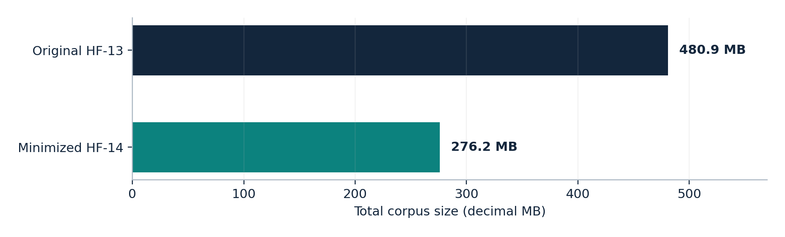

# Honggfuzz × libmobi | Memory-Safety Research

**Investigating a historical memory-safety vulnerability in a C-based MOBI e-book parser.**  
Honggfuzz · ASan · UBSan · Valgrind · Crash triage · Patch validation · LLVM coverage

> **Scope:** My Honggfuzz workstream in a university group project—not the group's AFL++ or zzuf/Radamsa work. The vulnerability was **already fixed upstream in 2022**; this is **independent reproduction and analysis**, not a new discovery or CVE.

## Key results

| **21** experiments | **1** historical bug | **−42.57%** corpus size | **0** coverage identifiers lost |
| :---: | :---: | :---: | :---: |
| 17 verified final summaries | Font XOR-key out-of-bounds read | 480.9 MB → 276.2 MB | Identical archived LLVM LCOV sets |

**Explore:** [Vulnerability](docs/VULNERABILITY.md) · [Experiments](docs/RESULTS.md) · [Technical report (PDF)](report/technical_report.pdf) · [Reproduction](docs/REPRODUCIBILITY.md)

## The vulnerability

A malformed MOBI `FONT` resource can supply an unchecked XOR-key offset. In **libmobi v0.10**, `mobi_decode_font_resource()` then reads outside the input buffer (`src/util.c`, around line 2543).

- **Reproducer:** One modified byte (`0x00 → 0xFF`) at offset **15,378** in an 84,412-byte input.
- **Confirmation:** ASan detected the fault; Valgrind reported **`Invalid read of size 1`**. Crashes from **HF-09, HF-13 and HF-19** shared one root cause.
- **Reduction:** Structure-aware input minimization produced a **15,531-byte** reproducer (**~81.6% smaller**).
- **Mitigation:** A [demonstration bounds-check patch](patches/font_xor_bounds_check.patch) was evaluated in **12 ASan** and **6 Valgrind** regression executions; the same fault was not observed in patched test cases. This is not proof of complete memory safety.

**Attribution:** Upstream had already [fixed the boundary checks (April 2022)](https://github.com/bfabiszewski/libmobi/commit/811bac3d32ec06d86cb131008d30dfa4b8ca1336) and [hardened them (May 2022)](https://github.com/bfabiszewski/libmobi/commit/6269ea673cb583f7a2aab92dd0f8113274742b7d). The research patch was not submitted upstream. No exact CVE is attributed to this flaw here.

[Full root-cause and regression analysis →](docs/VULNERABILITY.md)

## Methodology and selected experiments


**Target:** [libmobi](https://github.com/bfabiszewski/libmobi) v0.10 (`aac5b1f578b284b2f886d6d25cde22a33d8534f8`) · **Format:** MOBI · **CLI:** `mobitool`  
**Environment:** Kali Linux 2026.3 (VMware), Clang 21.1.8, Honggfuzz, ASan, UBSan and Valgrind.

I built instrumented variants, ran **21 numbered campaigns**, triaged crashes and timeouts, investigated a 15-token dictionary, minimized crashing inputs and corpora, and checked a defensive patch. **Four campaigns lack parseable final summaries**; configuration errors and minimization jobs are not treated as controlled fuzzing runs.


| ID | Condition | Executions | Outcome |
| --- | --- | ---: | --- |
| HF-09 | ASan; expanded corpus; 8 h | 565,277 | Historical crash |
| HF-12 | No ASan; 9 seeds; 1 h | 41,707 | No crash |
| HF-13 | ASan; 9 seeds; 1 h | 84,003 | Same historical crash |
| HF-19 | UBSan build + feedback; 1 h | 36,491 | Same fault, corroborated under ASan |

**Interpretation:** These iteration counts are *not* separately measured mutation operations. ASan/no-ASan results do not establish a causal throughput advantage. The UBSan run did not establish a distinct UBSan diagnostic. Dictionary experiments (two repeats per condition) showed no consistent benefit. HF-04's timeout-related signals are **not additional vulnerabilities**.

### Coverage-preserving minimization



The corpus went from **1,467 → 995 inputs** and **480,881,076 → 276,162,698 bytes**. Direct comparison of archived LCOV exports found exactly the same covered identifiers: **5,921 lines, 2,395 branches and 276 functions**. This is **LLVM source coverage**, not Honggfuzz's internal coverage metric.

[Complete campaign audit, dictionary comparisons and caveats →](docs/RESULTS.md)

## Verify the published data

```bash
python3 -m unittest discover -s tests -v
python3 scripts/compare_lcov.py data/coverage/original.lcov data/coverage/minimized.lcov
python3 scripts/summarize_campaigns.py data/campaigns.csv
```

These standard-library Python checks also run in [GitHub Actions](.github/workflows/data-validation.yml). **They validate published records; they do not rerun the original fuzzing campaigns or crashes.** The original MOBI seeds/crash files are omitted because redistribution permission was not established. A deterministic [one-byte reproducer generator](scripts/derive_reproducer.py) verifies the SHA-256 of a separately, lawfully obtained seed; see [reproducibility instructions](docs/REPRODUCIBILITY.md).

## Repository map

| Location | Contents |
| --- | --- |
| [Vulnerability write-up](docs/VULNERABILITY.md) | Root cause, minimization and regression |
| [Experimental results](docs/RESULTS.md) | 21 campaigns, comparison and limitations |
| [Full technical PDF](report/technical_report.pdf) | Detailed methodology and evidence |
| [Reproducibility](docs/REPRODUCIBILITY.md) | Build flags, environment and constraints |
| [`data/`](data/) and [`evidence/`](evidence/) | Coverage exports, audit table, sanitizer evidence |
| [`scripts/`](scripts/), [`tests/`](tests/), [`patches/`](patches/) | Audit automation, tests and defensive patch |
| [OSS-Fuzz check](docs/OSS_FUZZ_CHECK.md) | Public registration check (23 October 2026) |

**Skills demonstrated:** Coverage-guided fuzzing · C memory-safety analysis · Sanitizers · Crash deduplication · Root-cause analysis · Input/corpus minimization · Regression testing · LLVM LCOV · Python automation.

---

*Academic research completed October 2026. Historical bug credit belongs to the [libmobi maintainers](https://github.com/bfabiszewski/libmobi). No first discovery, upstream patch submission, or novel CVE is claimed. Four final logs are missing; see the [evidence limitations](docs/REPRODUCIBILITY.md) and [publication/attribution notes](docs/PUBLICATION_AND_ATTRIBUTION.md). No blanket license is asserted for all materials in this repository.*
