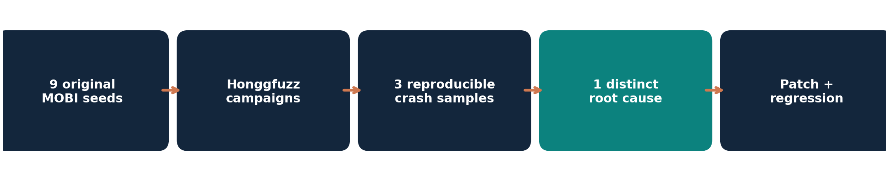
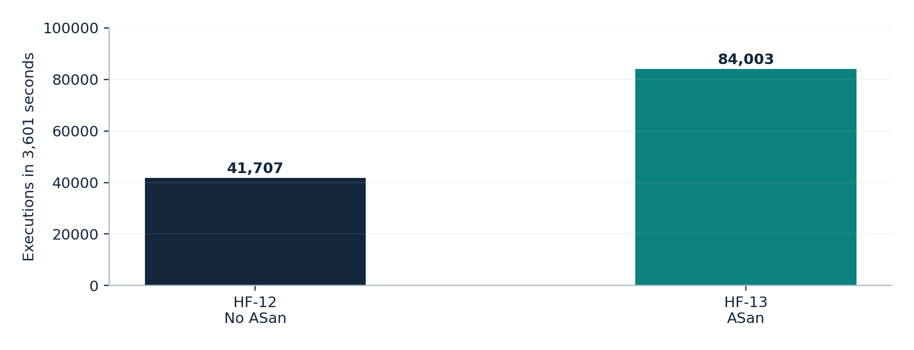

# libmobi v0.10 — Honggfuzz Memory-Safety Research

> **Portfolio case study:** coverage-guided fuzzing, crash triage, root-cause analysis, patch validation, and corpus minimization for an older C e-book parser.



**Target:** [libmobi](https://github.com/bfabiszewski/libmobi) **v0.10** (`aac5b1f578b284b2f886d6d25cde22a33d8534f8`)  
**File format:** MOBI e-books | **Harness:** `mobitool` CLI | **Fuzzer:** Honggfuzz  
**Runtime environment:** Kali Linux 2026.3 in VMware; Clang 21.1.8  
**Dynamic analysis:** AddressSanitizer (ASan), UndefinedBehaviorSanitizer (UBSan), and Valgrind Memcheck

**Scope:** This repository documents **my Honggfuzz workstream** within a group software-security fuzzing assignment; it does not claim to represent the group's AFL++ or zzuf/Radamsa work.

## What I investigated

I ran and analyzed **21 numbered Honggfuzz campaigns**, of which **17 have machine-readable final summaries**. The experimental comparisons include ASan vs. non-ASan instrumentation, UBSan coverage feedback, a format-specific dictionary, and corpus minimization. I reproduced and investigated **one distinct historical out-of-bounds read** in font-resource deobfuscation, then tested a defensive bounds-check patch against ASan and Valgrind evidence.

**Important:** This is a **rediscovery of an already-fixed historical issue**, *not* a previously unknown vulnerability or a new CVE. Upstream fixed the underlying boundary checks in April–May 2022, before libmobi v0.11. See [upstream initial fix](https://github.com/bfabiszewski/libmobi/commit/811bac3d32ec06d86cb131008d30dfa4b8ca1336) and [follow-up hardening](https://github.com/bfabiszewski/libmobi/commit/6269ea673cb583f7a2aab92dd0f8113274742b7d).

## Key results

| Result | Evidence |
| --- | --- |
| 21 numbered experiments; 17 parseable final summaries | [`data/campaigns.csv`](data/campaigns.csv) |
| 3 crashing test inputs, deduplicated to **1 historical root cause** | [Finding analysis](docs/VULNERABILITY.md) |
| HF-09: 565,277 executions in 28,801 seconds; 1 reported crash | [`data/campaigns.csv`](data/campaigns.csv) |
| Original 84,412-byte sample: **one-byte mutation at offset 15,378** reproduces the fault | [Input manifest](data/sample_manifest.json), [reproducer generator](scripts/derive_reproducer.py) |
| Structure-aware reduction to **15,531 bytes** (~81.6% smaller) | [Minimization notes](docs/VULNERABILITY.md) |
| Corpus minimization: **1,467 → 995 inputs** (32.17% reduction) | [`evidence/corpus_minimization.txt`](evidence/corpus_minimization.txt) |
| Corpus size: **480,881,076 → 276,162,698 bytes** (42.57% reduction) | [Minimization notes](docs/RESULTS.md) |
| Exact covered LCOV identifiers preserved: **5,921 lines / 2,395 branches / 276 functions** | [`data/coverage/`](data/coverage/), [`scripts/compare_lcov.py`](scripts/compare_lcov.py) |
| 12 recorded ASan regression cases (6 inputs × 2 builds) | [`data/regression_results.tsv`](data/regression_results.tsv) |
| 6 recorded Valgrind cases (3 inputs × 2 builds) | [Valgrind notes](evidence/valgrind_analysis.txt) |

**Caveat:** *Executions/iterations* are not a separately measured count of mutation operations. Honggfuzz's reported branch coverage is not the same metric as LLVM source coverage. Two dictionary repeats per configuration are insufficient to establish a statistically reliable performance difference.

## Experimental overview



- **With and without ASan:** Controlled smoke runs HF-10/11 and one-hour runs HF-12/13. The ASan run found a fault in HF-13; do **not** infer that ASan intrinsically improves throughput from these two runs.
- **Dictionary trials:** HF-15/16 and reversed-order repeats HF-20/21. The 15-token dictionary produced no consistent advantage over the baseline.
- **UBSan:** HF-17 lacked usable feedback instrumentation (0 guards); HF-18/19 enabled Honggfuzz coverage instrumentation (11,912 guards). HF-19 found an input reproducing the same historical bug; an explicit UBSan diagnostic for the bug was **not** established.
- **Crash counting:** HF-04 contained timeout-related `SIGVTALRM` events; those are **not** two new memory-safety vulnerabilities. HF-05/06 used unintended persistent mode and are not comparable with the controlled campaigns.

[All results and limitations →](docs/RESULTS.md)

## Root cause and remediation

The observed fault is in `mobi_decode_font_resource()` (libmobi v0.10 `src/util.c`, approximately line 2543). Malformed font-resource header fields can make the XOR-key offset point outside the valid buffer; the decoding loop then dereferences invalid memory. ASan showed a fault at the decoding site, and Valgrind identified an **invalid read of size 1**.

This workstream includes a [bounds-check patch](patches/font_xor_bounds_check.patch) and [regression evidence](data/regression_results.tsv). The patch prevented the same ASan-detected fault on the tested malformed inputs, with some inputs correctly rejected; this is **not** a proof of complete memory safety or a claim of an upstream contribution.

[Technical vulnerability write-up →](docs/VULNERABILITY.md)

## Reproducible checks (no MOBI redistribution needed)

Clone this repository, then run:

```bash
python3 scripts/compare_lcov.py data/coverage/original.lcov data/coverage/minimized.lcov
python3 scripts/summarize_campaigns.py data/campaigns.csv
python3 -m unittest discover -s tests -v
```

These commands use Python's standard library and validate the **published data**; they do not rebuild libmobi or rerun all 21 fuzzing campaigns.

To re-create the one-byte proof of concept locally, you must **legally obtain the exact original MOBI seed** whose SHA-256 is in [`data/sample_manifest.json`](data/sample_manifest.json). This repository does not redistribute third-party or permission-uncertain MOBI files:

```bash
python3 scripts/derive_reproducer.py /path/to/sample-obfuscated-fonts.mobi /tmp/one-byte-reproducer.mobi
```

[Full reproduction environment, build flags and boundaries →](docs/REPRODUCIBILITY.md)

## Repository guide

| Location | Content |
| --- | --- |
| [`report/technical_report.pdf`](report/technical_report.pdf) | Full technical report, including methodology, figures and limitations |
| [`docs/RESULTS.md`](docs/RESULTS.md) | Comparison of experimental conditions and findings |
| [`docs/VULNERABILITY.md`](docs/VULNERABILITY.md) | Root cause, reproducers, patch and regression interpretation |
| [`docs/REPRODUCIBILITY.md`](docs/REPRODUCIBILITY.md) | Target pinning, environment, commands and limitations |
| [`docs/OSS_FUZZ_CHECK.md`](docs/OSS_FUZZ_CHECK.md) | Public-registry investigation (23 Oct 2026) |
| [`data/campaigns.csv`](data/campaigns.csv) | Curated campaign audit; incomplete entries explicitly marked |
| [`data/coverage/*.lcov`](data/coverage/) | Published LLVM coverage exports with privacy-normalized source paths |
| [`data/regression_results.tsv`](data/regression_results.tsv) | Recorded vulnerable vs patched ASan regression outcomes |
| [`evidence/`](evidence/) | Small reports, representative sanitizer excerpts and build evidence |
| [`scripts/`](scripts/) | Portable audit scripts and deterministic one-byte reproducer generator |
| [`patches/`](patches/) | Researcher-authored demonstration patch for archived vulnerable v0.10 |

## Source, credit, disclosure and license scope

- Upstream library: [bfabiszewski/libmobi](https://github.com/bfabiszewski/libmobi), licensed **LGPL-3.0-or-later** by its authors. No copy of upstream libmobi source is distributed here.
- Honggfuzz is an independently maintained fuzzing tool; no copy of its source is distributed here.
- Historical bug credit belongs to upstream maintainers and original reporters. This work documents **independent reproduction and analysis**; it does not claim first discovery, upstream patch submission, or a novel CVE.
- The input samples/crash MOBI binaries and bulk fuzzing corpus are **not published**, pending redistribution-rights verification. Checksums and a generator are included instead.
- This repository isolates the Honggfuzz workstream from other students' contributions. See [attribution notes](docs/PUBLICATION_AND_ATTRIBUTION.md) before publication.
- **No blanket license has been granted for the entire repository.** If adding a license, ensure you have the rights to license every included file, and preserve independent upstream licenses.

**Research completed:** October 2026 | **Status:** retrospective test of an outdated, fixed target release.
