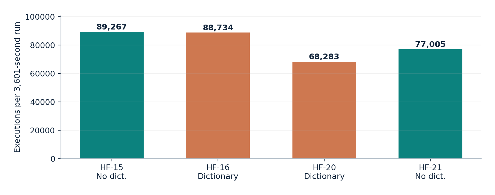
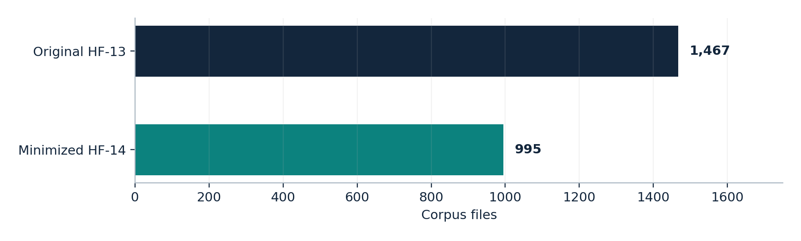

# Experiments and measured outcomes

All experiment identifiers reference [`data/campaigns.csv`](../data/campaigns.csv), derived from the stored Honggfuzz final summaries. **17 of 21 numbered campaigns** had extractable final summaries. The missing/incomplete entries are HF-02, HF-03, HF-06 and HF-07; do not invent values for them.

## Main campaigns

| Experiment | Condition | Seeds | Duration | Executions | Reported crashes | Honggfuzz coverage |
| --- | --- | ---: | ---: | ---: | ---: | ---: |
| HF-09 | ASan extended, expanded prior corpus | 796 | 28,801 s | 565,277 | 1 | 22% |
| HF-10 | No ASan smoke | 9 | 61 s | 768 | 0 | 17% |
| HF-11 | ASan smoke | 9 | 61 s | 1,189 | 0 | 17% |
| HF-12 | No ASan, 1h | 9 | 3,601 s | 41,707 | 0 | 20% |
| HF-13 | ASan, 1h | 9 | 3,601 s | 84,003 | 1 | 20% |
| HF-14 | Corpus minimization (`-M`) | 1,467 | 990 s | 24,191 | 0 | 20% |
| HF-15 | Without dictionary | 9 | 3,601 s | 89,267 | 0 | 20% |
| HF-16 | With dictionary | 9 | 3,601 s | 88,734 | 0 | 20% |
| HF-17 | UBSan, without Honggfuzz coverage guards | 9 | 61 s | 2,778 | 0 | 0% |
| HF-18 | UBSan + feedback smoke | 9 | 61 s | 677 | 0 | 11% |
| HF-19 | UBSan + feedback, 1h | 9 | 3,601 s | 36,491 | 1 | 13% |
| HF-20 | Dictionary repeat | 9 | 3,601 s | 68,283 | 0 | 19% |
| HF-21 | No-dictionary repeat | 9 | 3,601 s | 77,005 | 0 | 20% |

**Important comparability notes:** HF-09 started from an expanded 796-file corpus, unlike the 9-file controlled runs. HF-14 is a minimization job, not a regular fault-discovery run. HF-17 had zero feedback guards and therefore should not be called coverage-guided. The two HF-04 SIGVTALRM-related events are not unique memory-safety flaws. HF-05/06 involved incorrect persistent-mode use and are excluded from controlled comparisons.

## Dictionary repeats

| Configuration | IDs | Mean executions | Mean new units | Reported coverage |
| --- | --- | ---: | ---: | --- |
| Without dictionary | HF-15, HF-21 | 83,136 | 1,346.5 | 20%, 20% |
| With dictionary | HF-16, HF-20 | 78,508.5 | 1,358 | 20%, 19% |

Four campaigns are insufficient to claim a robust performance advantage. Apparent execution-rate changes may reflect run-to-run variability and memory pressure. **No additional crashing fault** emerged in the four dictionary runs.



## Coverage-preserving corpus minimization

HF-14 reduced the HF-13 corpus from 1,467 to 995 files (−32.17%), and 480,881,076 bytes to 276,162,698 bytes (−42.57%). The original and minimized coverage exports contain exactly the same sets of **5,921 covered line identifiers**, **2,395 covered branch identifiers**, and **276 covered function identifiers**.



The reproducible comparison script uses `SF`, `DA`, `BRDA` and `FNDA` LCOV records. It establishes equality of **published source-coverage identifiers under the recorded build**, not equality of Honggfuzz's own internal coverage signal and not proof of perfect input equivalence. Original raw LCOV locations were normalized from absolute Kali project paths to relative `libmobi/src/...` paths for the public repository, with counters otherwise unmodified.

```bash
python3 scripts/compare_lcov.py data/coverage/original.lcov data/coverage/minimized.lcov
```

## Reflections

- Instrumentation is valuable for reliable bug characterization, but raw execution throughput alone does not establish sanitizer effectiveness. HF-12/13 had the same nominal runtime but markedly different executions: they do not isolate the sanitizer as the sole causal factor.
- Crash counts require **deduplication by behavior and root cause**. The three crashing experiments corresponded to one historical font-decoder defect.
- Runtime configuration errors matter: direct mode with unintended persistence and UBSan without coverage feedback produced misleading experimental conditions.
- Source-level corpus coverage can be retained with materially fewer samples and bytes, improving future corpus management.
- The record does not provide separately measured mutation counts. We report `iterations`/executions instead and do not equate them to individual byte-level mutations.

[Complete audit and graphs →](../report/technical_report.pdf)
